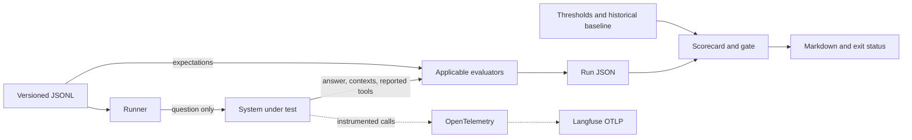

# agent-eval-platform

**An applied AI engineering lab for evaluating Azure architecture answers and agent tool use.**

Prompt changes can improve the wording of an answer while weakening its correctness.
This Python project makes that trade-off inspectable: versioned test cases, three
evaluator families, a scorecard, and a failing check when configured quality limits
are crossed. It connects cloud engineering concerns—identity, observability, cost
and change control—with evaluation of LLM-based systems.

**Status:** portfolio lab with a working CLI and an Azure-backed example. Local
verification is dated [2026-10-10](docs/validation-2026-10-10.md). The committed
model results and successful hosted workflows are historical **2026-08-04**
evidence, not a new cloud validation. Human calibration remains pending, and
position bias exceeds the stated target.

## Try it locally — no model calls or credentials

Prerequisites: Git, Python **3.12**, and **uv**. Run commands from the repository
root. Installation downloads the versions in `uv.lock`; the commands after it
can run offline. You do not need `.env`, an Azure subscription, or Langfuse keys.

```bash
git clone https://github.com/marvicqui/agent-eval-platform.git
cd agent-eval-platform
uv sync --frozen --dev --no-editable
uv run --offline --frozen --no-editable pytest tests/ -v
uv run --offline --frozen --no-editable aep dataset stats rag_qa
uv run --offline --frozen --no-editable aep dataset stats agent_tasks
uv run --offline --frozen --no-editable python -m examples.offline_demo
```

The demo prints `allowed: PASS` and `forbidden: FAIL (expected)`, then exits 0.
It supplies synthetic tool-call lists to the real trajectory evaluator and gate;
it does not execute those tools or measure model quality. See the
[90-second walkthrough](docs/demo-90-seconds.md) and [test guide](docs/testing.md).

## What is implemented

| Component | Behavior in this repository |
|---|---|
| Golden datasets | 30 Azure WAF/CAF Q&A cases and 6 agent trajectory cases, stored as validated JSONL |
| SUT contract | `run(question)` returns an answer, retrieved contexts and reported tool names; the runner does not pass expected answers |
| Runner | Async case execution with a concurrency cap and bounded retries for HTTP 429/5xx errors |
| Trajectory evaluator | Checks required/forbidden tools, repeated patterns and ordering; any reported forbidden call fails the gate |
| RAG evaluator | RAGAS faithfulness, answer relevancy, context precision and context recall |
| Rubric judge | Validated structured scores, both-order pairwise comparisons and a deployment-name guard against self-judging |
| Scorecard | Metric means, baseline deltas, evaluator error counts and bias monitors |
| Observability | Instrumented SUT calls export OpenTelemetry spans to Langfuse over OTLP; token-based cost estimates are computed locally |
| GitHub Actions | Deterministic CI with socket-denied unit tests; `eval.yml` is a manual review placeholder with no model calls or Azure login |

The minimal RAG example retrieves from the committed cases' context excerpts and
source metadata. It does not pass reference answers to the model, but this is a
small, dataset-derived corpus, not a held-out production benchmark. The trajectory
oracle trusts `SUTResult.tool_calls`; it does not reconstruct calls from traces or
prevent an action before it happens.

## Architecture



The online CLI initializes Azure-dependent evaluators and the tracing exporter;
the offline demo calls the deterministic components directly. The
[architecture guide](docs/architecture.md) maps each boundary to source files and
records the trade-offs. The original SVG remains a historical overview.

## Historical model results — 2026-08-04

The committed [baseline](evals/baseline.json) records 30 `rag_qa` cases with
`minimal-rag` and judge deployment `gpt-small`. The original run documentation
identifies gpt-5-mini as the SUT, judge and RAGAS model.

| Metric | Stored value | Current configured floor / monitor target |
|---|---:|---:|
| Faithfulness | 0.9345 | ≥ 0.85 |
| Answer relevancy | 0.7572 | ≥ 0.70 |
| Context precision | 1.0000 | ≥ 0.70 |
| Context recall | 0.8521 | ≥ 0.70 |
| Judge overall | 0.8683 | ≥ 0.70 |
| Position flip rate | **0.2667** | **< 0.10 — not met** |
| Verbosity correlation | 0.2686 | \|r\| < 0.30 — monitor only |

Turning inconsistent pairwise verdicts into ties limits their use; it does not
prove the judge is reliable or correct the separate rubric score. Both bias
metrics are reported, not enforced by `evaluate_gate`. A different judge model
does not automatically enable new gates.

The stored `$0.029175` is a historical **SUT-only estimate**. Judge and RAGAS
traffic are outside that accumulator; this repository does not establish a
complete run cost or a current monthly infrastructure budget. Unknown model
prices are flagged per call, so a numeric total may still be incomplete.
See [metric definitions and evidence limits](docs/metrics.md).

## Quality gate and evidence

`aep report` checks the five configured metric floors and permits a maximum
drop of 0.05 from the baseline. A reported forbidden tool call fails regardless
of quality scores. A completely missing thresholded metric fails; partial
evaluator failures can still leave a passing mean. Review coverage and errors
alongside the verdict.

[PR #1](https://github.com/marvicqui/agent-eval-platform/pull/1) preserves the
historical prompt-regression demonstration. The historical
[CI run](https://github.com/marvicqui/agent-eval-platform/actions/runs/30893874232)
and [successful evaluation run](https://github.com/marvicqui/agent-eval-platform/actions/runs/30889826206)
are from August 4. A failing check only enforces merge blocking when repository
rules require it; the October 10 branch lookup reported `main` as unprotected.

## Run the Azure-backed example

This path sends data to external services and incurs model usage charges.
Use [the online setup guide](docs/quickstart-online.md) after the offline checks.
It requires existing Azure model deployments, an authorized identity and Langfuse
credentials. `--no-evaluate` still runs the SUT and initializes tracing; it is
**not an offline switch**.

## Decisions and boundaries

- [ADR-0001](docs/adr/0001-opentelemetry-over-vendor-sdk.md): OpenTelemetry keeps instrumentation separate from the trace backend.
- [ADR-0002](docs/adr/0002-dataset-in-git-not-database.md): JSONL in Git makes changes to test expectations reviewable.
- [ADR-0003](docs/adr/0003-llm-judge-plus-deterministic-oracles.md): deterministic violations cannot be overruled by a high judge score.
- [ADR-0004](docs/adr/0004-oidc-federation-over-ci-secrets.md): Azure workload federation avoids a stored Azure client secret; Langfuse credentials remain secrets.

Human calibration tooling exists, but there is no completed human-label file or
calibration report in this snapshot. The 20-case annotation template must be
scored by a person; no agreement result is claimed. The same-model judge
override is enabled in the historical evaluation workflow. These and other
[known limitations](docs/limitations.md) are part of the evidence, not hidden
behind the pass/fail status.

This lab is not a hosted product, production deployment, runtime authorization
layer, or general-purpose agent framework. Other portfolio projects are outside
this repository's validation scope. Development uses AI assistance; commit
history retains existing author and co-author attribution.

## Security

The online clients use `DefaultAzureCredential`. Active workflows request no Azure
OIDC token and run no inference. The former automatic evaluation has been replaced
by a manual review placeholder; see [CI separation](docs/ci-proposal/README.md).
Local `.env` and run artifacts are ignored by Git. Review
[security and data handling](docs/security.md) before online runs or CI changes,
including the boundaries of secret scanning, PR trust, and diagnostic outputs.

## License

[MIT](LICENSE).
